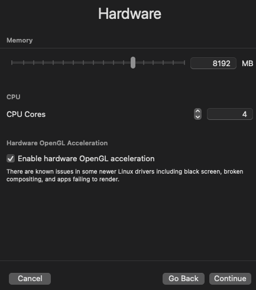
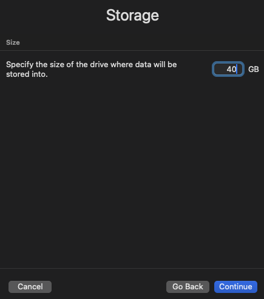
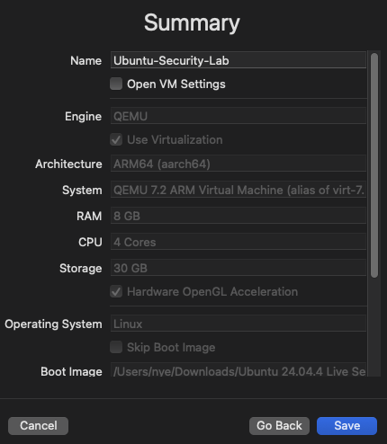
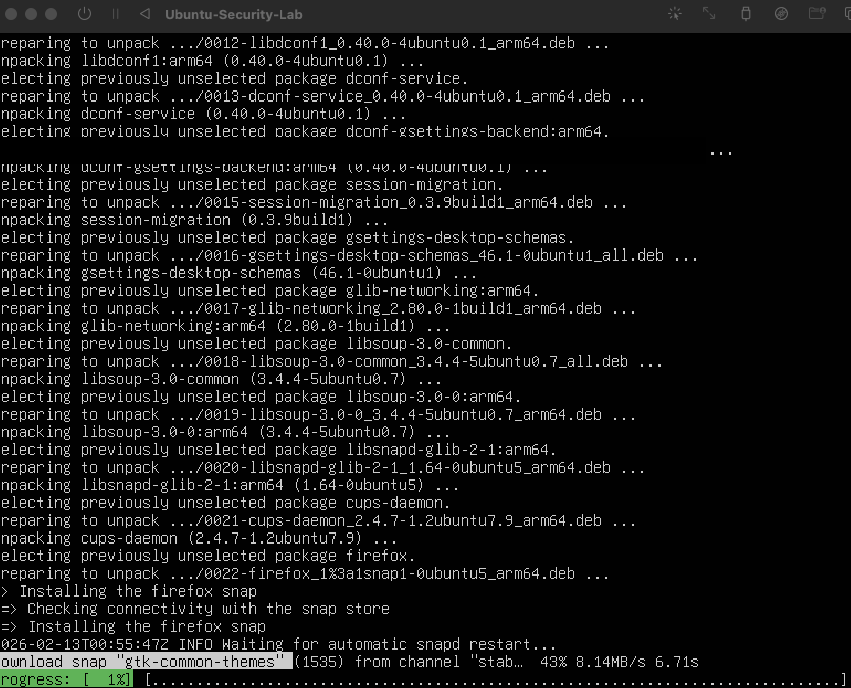
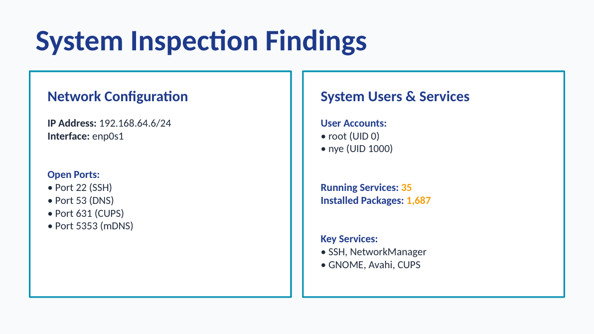
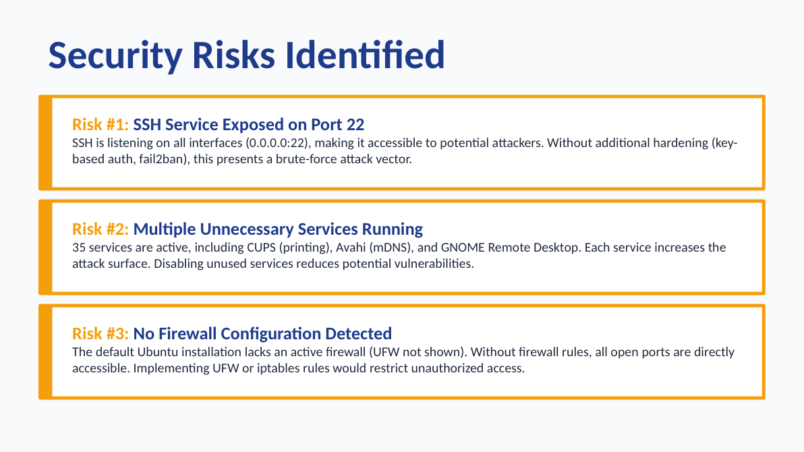

# Lab 01: Environment Setup & Baseline Security Assessment

## Overview
Built an Ubuntu virtual machine from scratch and took a baseline inventory of the system: OS version, open ports, running services, network configuration, and local users. The goal was to know exactly what a fresh install exposes before hardening anything.

## Objectives
- Create a working VM
- Identify system components
- Establish a baseline security posture

## Environment / Tools
- UTM on macOS (Apple silicon), Ubuntu 24.04 LTS (ARM64)
- 2 vCPU, 4 GB RAM, 40 GB disk
- `lsb_release`, `netstat`, `systemctl`, `ip`, `dpkg`

## Steps

### 1. Create the VM




### 2. Install Ubuntu and a desktop
```bash
sudo apt update
sudo apt install tasksel
sudo apt install ubuntu-desktop
```


### 3. Inspect the system
```bash
lsb_release -a                                         # OS version
sudo netstat -tuln                                     # listening ports
systemctl list-units --type=service --state=running    # running services
ip addr                                                # network config
grep -E "/bin/bash|/bin/sh" /etc/passwd                # accounts with a login shell
dpkg -l | wc -l                                        # installed package count
```

## Findings


| Area | Result |
|------|--------|
| Users with a shell | `root` (UID 0), `nye` (UID 1000) |
| Listening ports | 22 (SSH), 53 (DNS), 631 (CUPS), 5353 (mDNS) |
| Running services | 35 |
| Installed packages | 1,687 |



1. **SSH exposed on all interfaces (0.0.0.0:22).** No key-only auth or fail2ban yet, so it's a brute-force target.
2. **Unnecessary services running.** CUPS, Avahi (mDNS), and GNOME Remote Desktop all add attack surface on a machine that doesn't need them.
3. **No firewall rules.** UFW wasn't active, so every listening port was reachable.

## What I learned
- A default desktop install is not a secure baseline. It ships with services most systems never use.
- Taking an inventory first gives you something to measure hardening against later (see [Lab 06](../06-patch-management-hardening/)).

## Skills demonstrated
Virtualization, Linux system inspection, attack surface analysis, documentation
