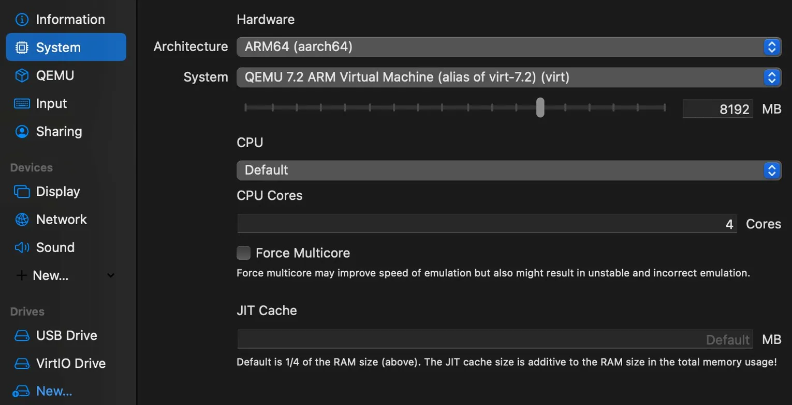
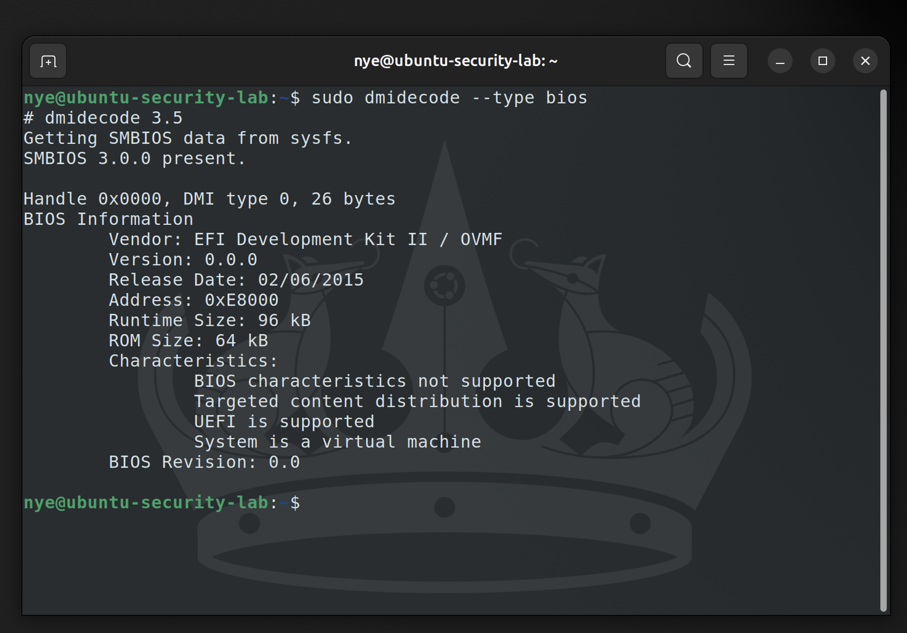
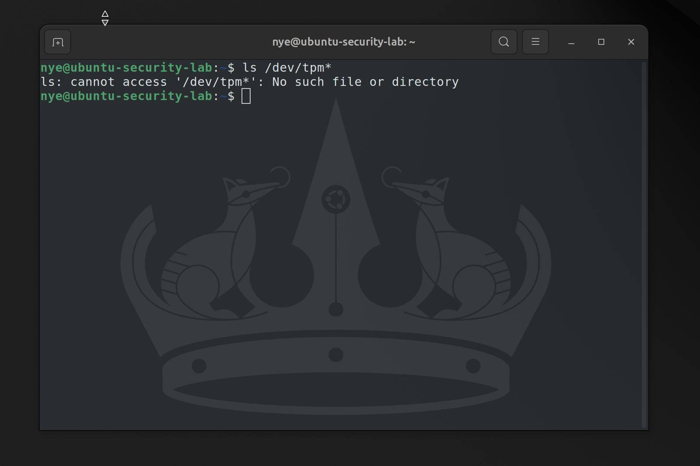
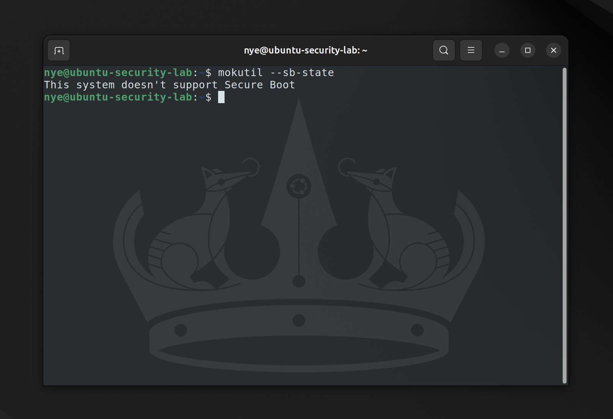

# Lab 02: Hardware Components & Platform Security

## Overview
Checked what firmware-level protections my VM actually has (UEFI, Secure Boot, TPM) and wrote up why those protections matter as the root of trust for everything above them.

## Objectives
- Identify the VM's hardware and firmware configuration
- Check Secure Boot and TPM status
- Explain the role of firmware in platform security

## Environment / Tools
- UTM (QEMU 7.2 ARM virtual machine), ARM64, 4 cores, 8 GB RAM
- Ubuntu 24.04 LTS
- `dmidecode`, `mokutil`, `/dev/tpm*`

## Steps

### 1. Review the VM's system settings


### 2. Confirm firmware type
```bash
sudo dmidecode --type bios
```


### 3. Check for a TPM
```bash
ls /dev/tpm*
```


### 4. Check Secure Boot
```bash
mokutil --sb-state
```


## Findings
| Check | Result |
|-------|--------|
| Firmware | UEFI (UTM's default) |
| Secure Boot | Not supported by UTM's ARM64 firmware |
| TPM | Not present (no `/dev/tpm*` device) |

**Why it matters**
- Firmware runs before the OS, which makes it the first link in the chain of trust. Malware that lives there (bootkits) loads before antivirus or OS access controls can do anything about it.
- Secure Boot verifies the bootloader's signature before it runs. Without it, nothing stops a modified bootloader from loading.
- A TPM enables measured boot. Each boot component's hash goes into the PCRs, so you can attest that a machine booted into a known-good state, and keys can be sealed so they're only released when those measurements match.
- LoJax (2018, attributed to APT28) is a real example: a UEFI rootkit written to SPI flash that survives OS reinstalls.

## What I learned
Software defenses can't fix a compromised boot chain. A VM with no Secure Boot and no TPM is fine for a lab but wouldn't be acceptable for a production system handling sensitive data.

## Skills demonstrated
Firmware and boot security concepts, Linux hardware inspection, threat research (bootkits / UEFI rootkits)
