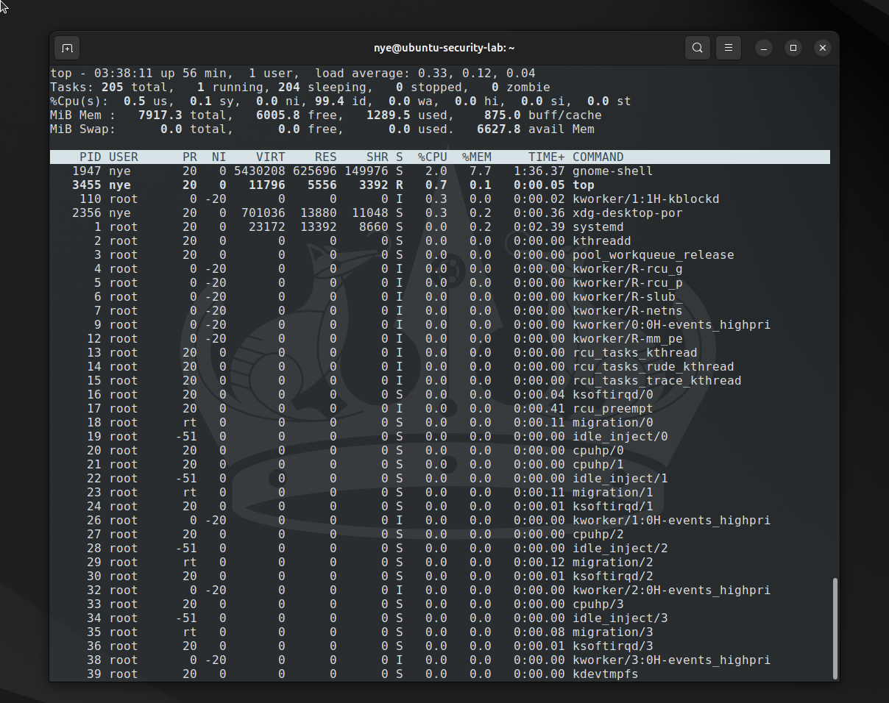
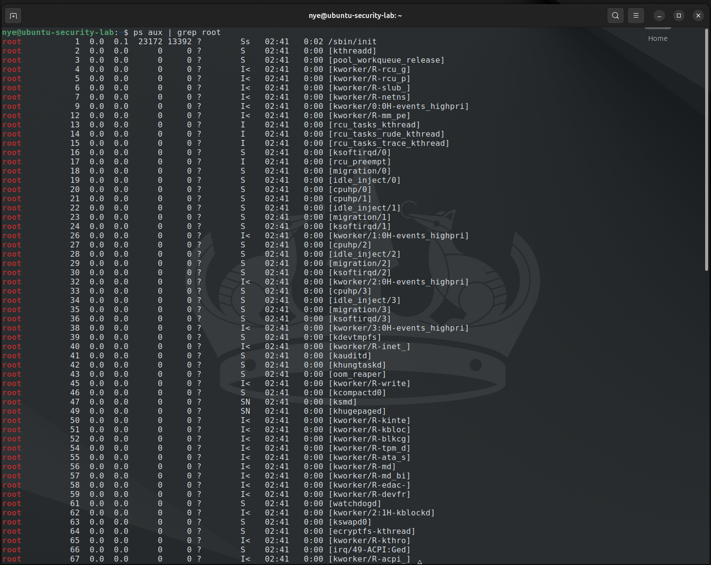
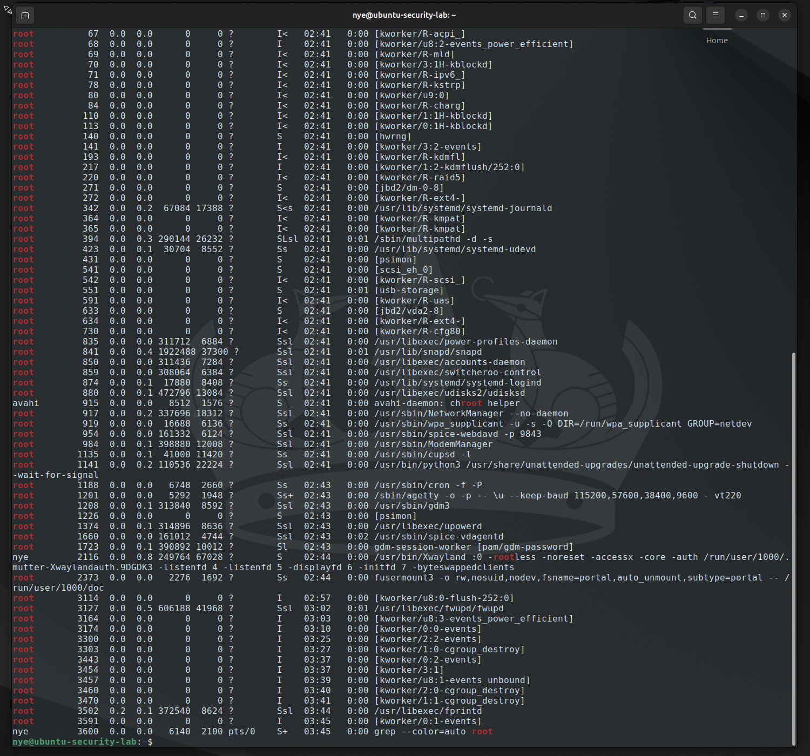
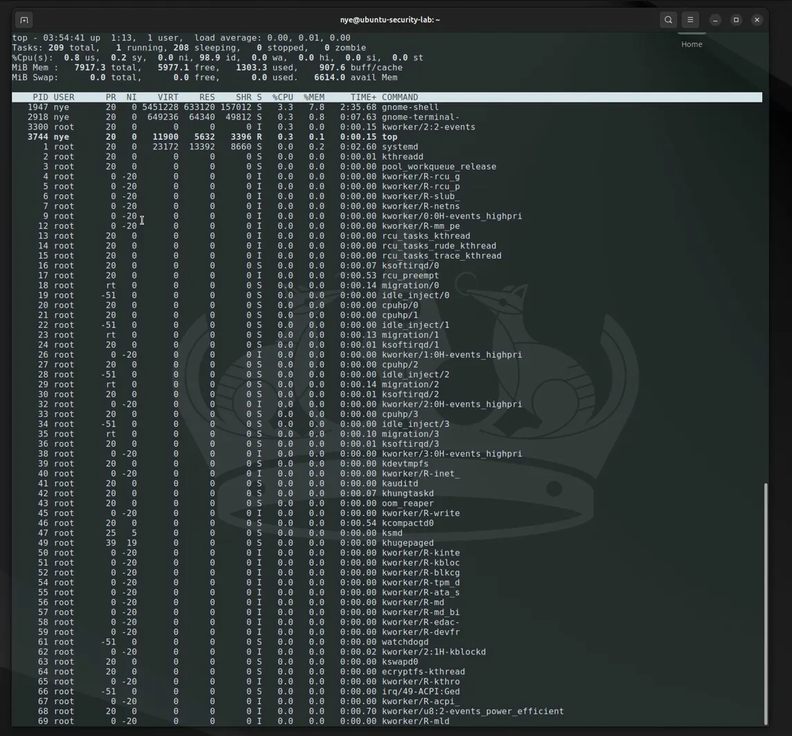
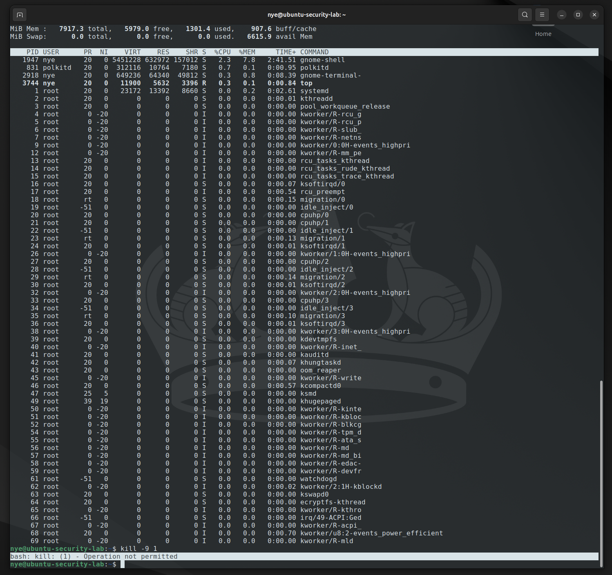

# Lab 03: OS Architecture & Process Isolation

## Overview
Looked at how Linux separates processes and privileges: listed running and root-owned processes, watched resource usage, and tested whether a normal user can kill a root-owned process.

## Objectives
- View running processes and identify privileged ones
- Inspect CPU and memory usage
- Test process isolation between users

## Environment / Tools
- Ubuntu 24.04 LTS VM (UTM)
- `ps`, `top`, `grep`, `kill`

## Steps

### 1. View running processes
```bash
ps aux
```


### 2. Identify privileged processes
```bash
ps aux | grep root
```



### 3. Inspect memory and CPU usage
```bash
top
```


### 4. Test process isolation
As a normal user, try to kill PID 1 (`systemd`, owned by root):
```bash
kill -9 1
```


## Findings
- Core services (`systemd`, kernel workers, update services) run as root.
- The kill attempt against PID 1 was denied with "Operation not permitted". The kernel enforces user boundaries even for a signal as blunt as `SIGKILL`.

## What I learned
Process isolation is what keeps one compromised process from taking over the whole system. It's the base that multi-user security and privilege separation are built on, and it's why running services as root is such a big deal.

## Skills demonstrated
Linux process management, privilege separation, security models
