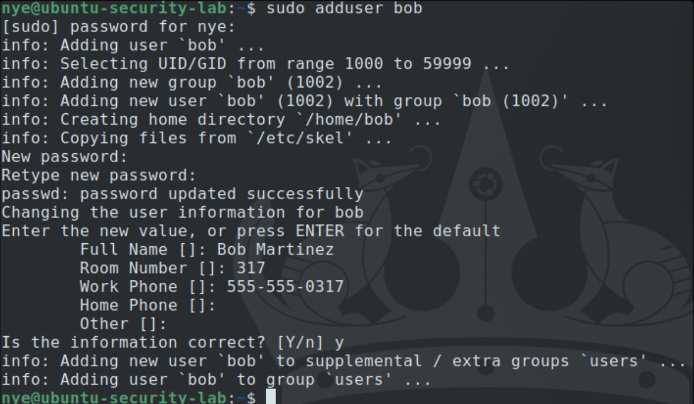
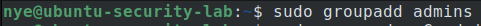
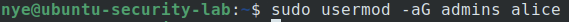
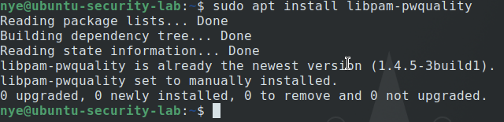
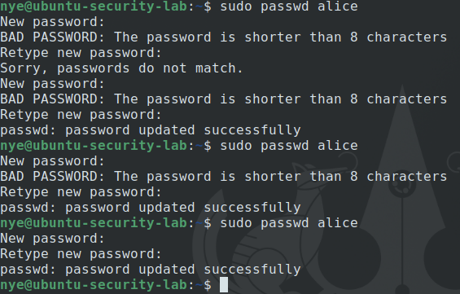
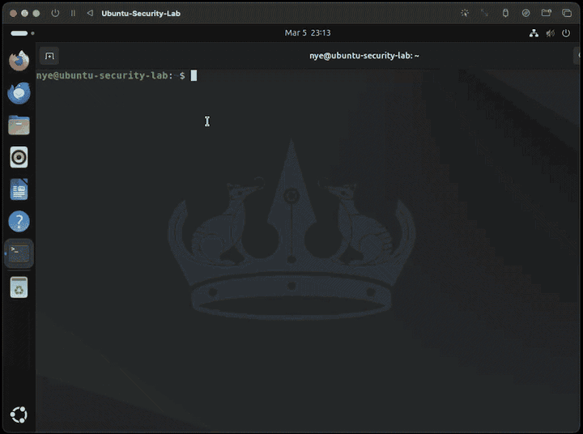
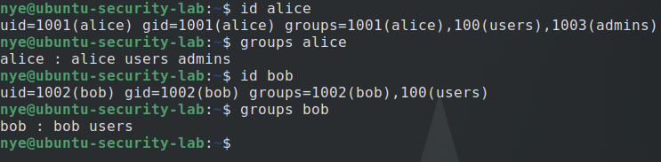

# Lab 04: Account Management & Authentication Policies

## Overview
Created users and groups to apply least privilege, then enforced a password-quality policy with PAM and tested it against weak passwords.

## Objectives
- Apply least privilege
- Enforce authentication policies

## Environment / Tools
- Ubuntu 24.04 LTS VM
- `adduser`, `groupadd`, `usermod`, `libpam-pwquality`

## Steps

### 1. Create users
```bash
sudo adduser alice
sudo adduser bob
```


### 2. Create an admin group and add only Alice
```bash
sudo groupadd admins
sudo usermod -aG admins alice
```



### 3. Configure a password policy
```bash
sudo apt install libpam-pwquality
```


### 4. Test weak passwords
| Password tried | Why it should fail | Result |
|----------------|--------------------|--------|
| `123` | Too short and simple | Rejected |
| `alice` | Matches the username | Rejected |
| `password` | Common dictionary word | Rejected |




## Findings


Alice is in `admins`; Bob is a standard user only. Each account has just the access its role needs.

## What I learned
- Group membership is the simplest way to apply least privilege on Linux.
- PAM modules like `pam_pwquality` enforce password rules at the OS level, so they apply no matter how the password gets changed.

## Skills demonstrated
Linux user and group administration, least privilege, PAM authentication policy
