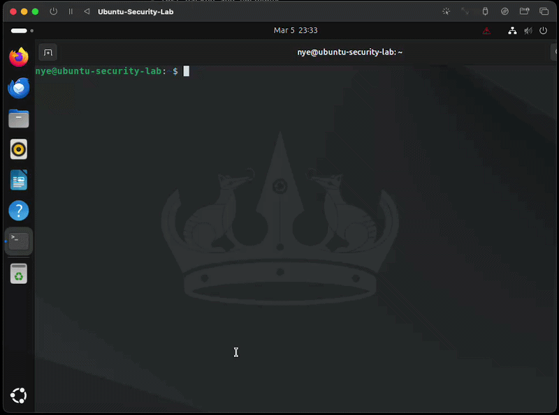
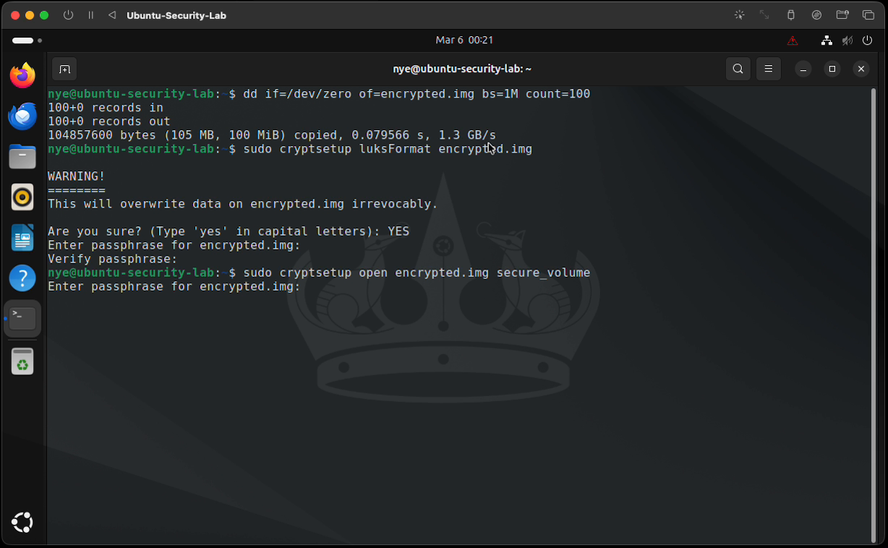
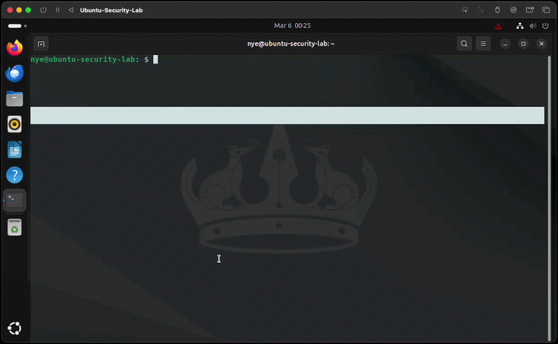
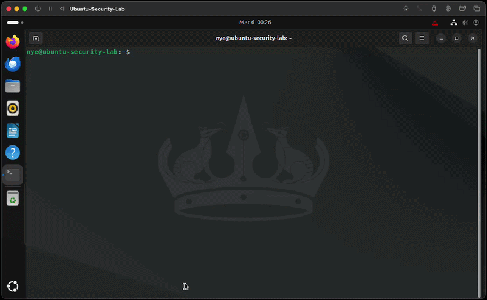
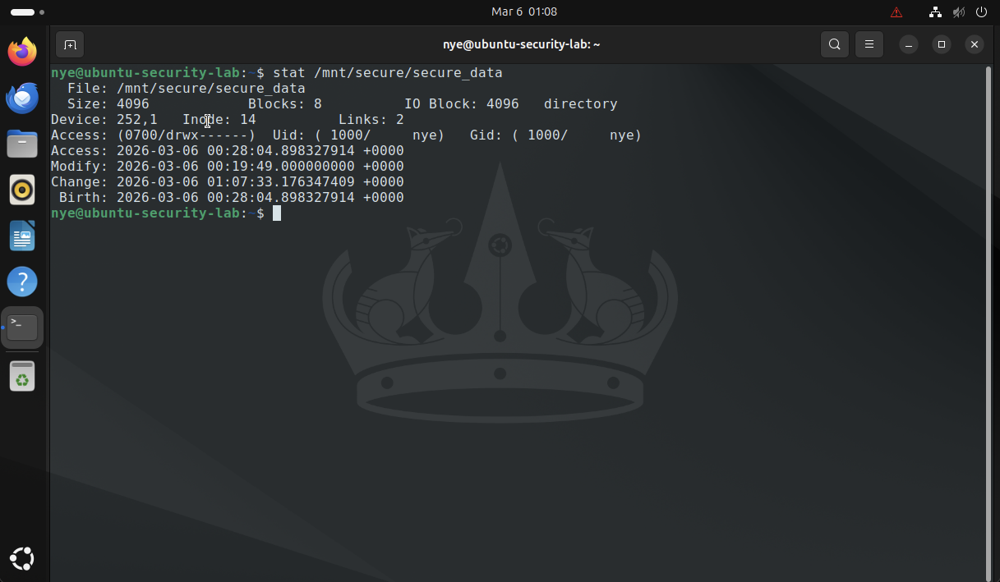
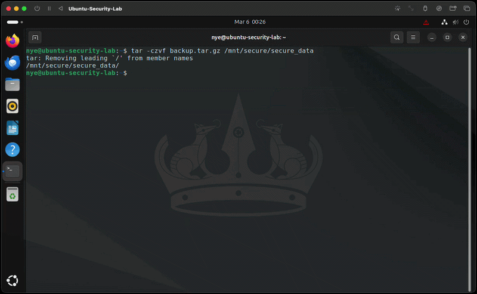
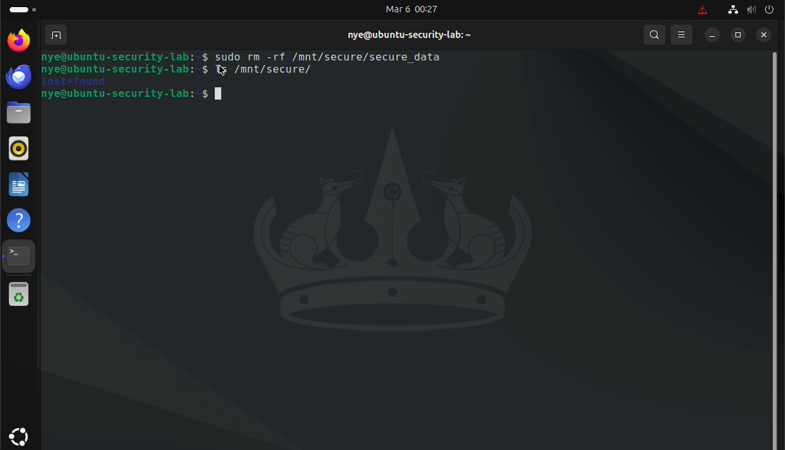

# Lab 05: File Systems, Storage & Backup Security

## Overview
Protected data at rest with permissions and LUKS encryption, then created a backup, deleted the original, and restored it to prove recovery works.

## Objectives
- Secure data at rest
- Test backup and recovery

## Environment / Tools
- Ubuntu 24.04 LTS VM
- `chmod`, `cryptsetup` (LUKS), `tar`

## Steps

### 1. Restrict permissions
```bash
mkdir secure_data
chmod 700 secure_data    # owner only
```


### 2. Add encryption
The VM had been installed without full-disk encryption, so I created a LUKS-encrypted container for `secure_data` instead:
1. Created the container file
2. Formatted it with LUKS
3. Opened (unlocked) it
4. Created a filesystem and mounted it
5. Moved `secure_data` into it



### 3. Back up
```bash
tar -czvf backup.tar.gz secure_data
```


### 4. Simulate data loss and restore


## Findings




- `secure_data` was only accessible by its owner (`drwx------`).
- After deleting the directory, it was restored from `backup.tar.gz` with its contents intact.

## What I learned
- Permissions and encryption protect against different things: permissions stop other users on a running system, encryption protects data if the disk is taken.
- A backup only counts once you've tested restoring it.
- A real deployment would also keep the backup somewhere other than the same disk, and encrypted.

## Skills demonstrated
Linux file permissions, LUKS encryption, backup and recovery testing
