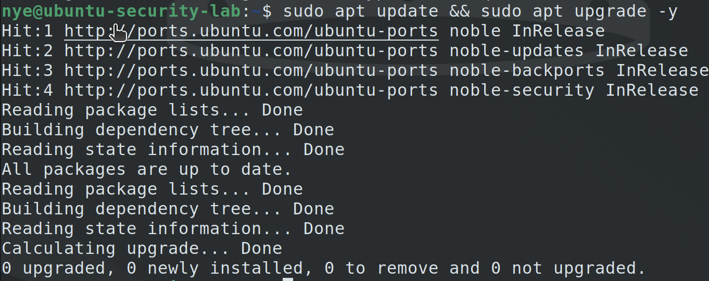
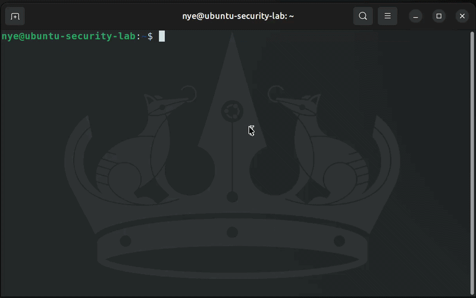
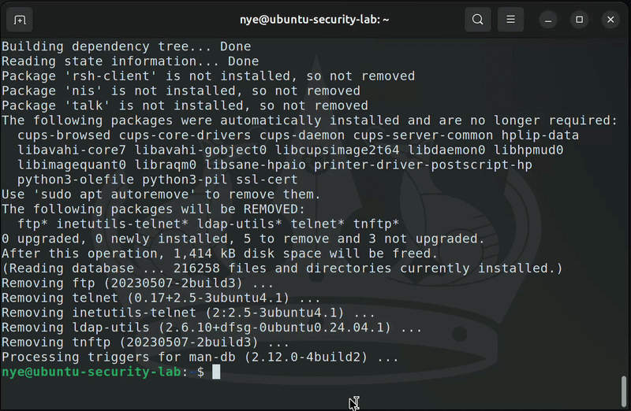
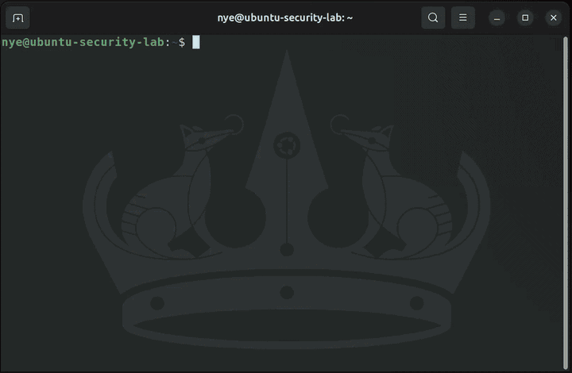
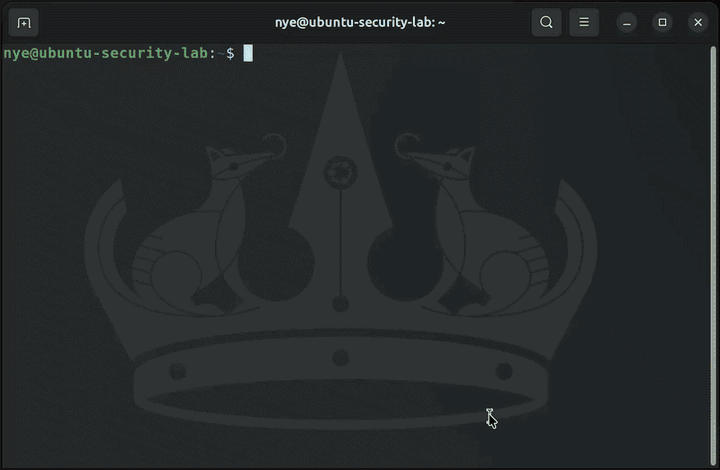
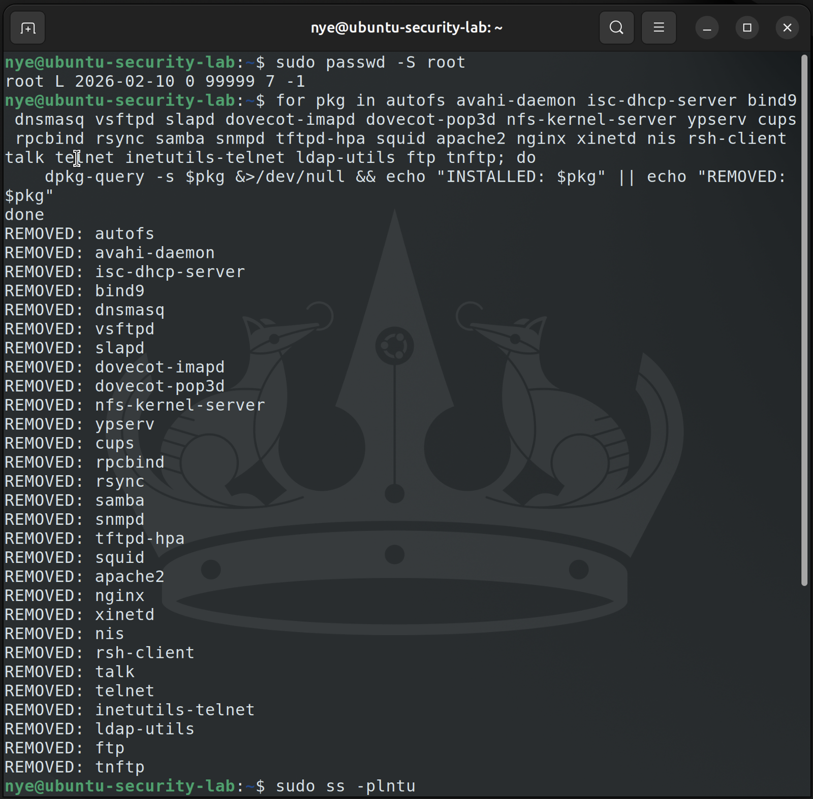

# Lab 06: Patch Management & System Hardening

## Overview
Patched the VM, then hardened it using controls from the CIS Ubuntu 24.04 LTS Benchmark: removed unused services and clients, locked the root account, and verified the final state with a script.

## Objectives
- Patch vulnerabilities
- Harden configurations

## Environment / Tools
- Ubuntu 24.04 LTS VM
- `apt`, `dpkg-query`, `passwd`, CIS Ubuntu 24.04 LTS Benchmark v1.0

## Steps

### 1. Update and upgrade
```bash
sudo apt update && sudo apt upgrade
```


### 2. Identify unpatched packages


### 3. Remove services and clients that CIS recommends disabling
| CIS section | Removed |
|-------------|---------|
| 2.1.x (server services) | autofs, Avahi, DHCP server, DNS server, dnsmasq, FTP, LDAP, mail (IMAP/POP3), NFS, NIS, CUPS, rpcbind, rsync, Samba, SNMP, TFTP, Squid, web server, xinetd |
| 2.2.x (clients) | NIS, RSH, Talk, Telnet, LDAP, FTP clients |

Verification script:
```bash
for pkg in autofs avahi-daemon isc-dhcp-server bind9 dnsmasq vsftpd slapd \
  dovecot-imapd dovecot-pop3d nfs-kernel-server ypserv cups rpcbind rsync samba \
  snmpd tftpd-hpa squid apache2 nginx xinetd nis rsh-client talk telnet \
  inetutils-telnet ldap-utils ftp tnftp; do
    dpkg-query -s "$pkg" &>/dev/null && echo "INSTALLED: $pkg" || echo "REMOVED: $pkg"
done
```

### 4. Lock root login
```bash
sudo passwd -l root
```


### 5. Verify system state


## Findings



- System fully patched, with no pending upgrades
- 25 CIS 2.1.x / 2.2.x items addressed and confirmed by script
- Root account locked, so admin access goes through `sudo`

This closes out most of the baseline risks from [Lab 01](../01-environment-setup-baseline/), especially the extra services.

## What I learned
- Benchmarks like CIS turn "harden the system" into a checklist you can actually verify.
- Writing a short verification script is faster and more reliable than checking each package by hand.

## Skills demonstrated
Patch management, CIS Benchmarks, Linux hardening, Bash scripting
