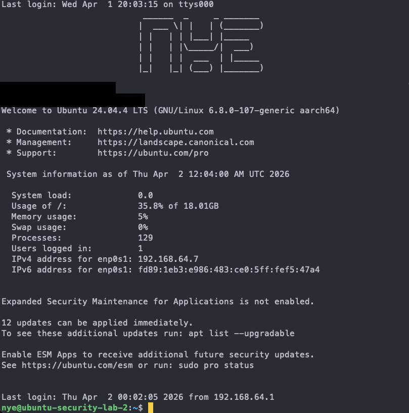
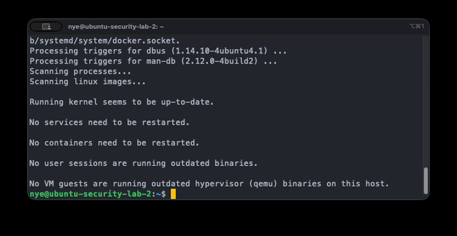
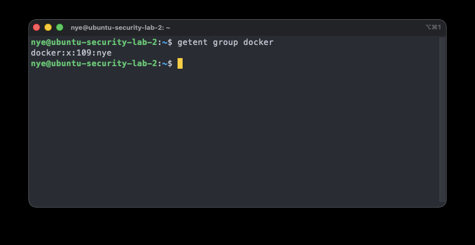
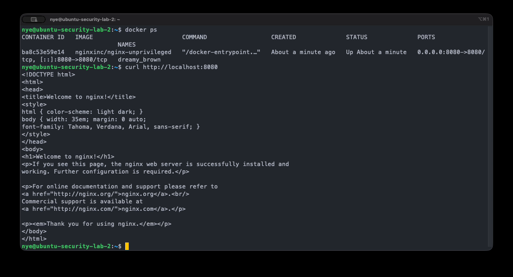
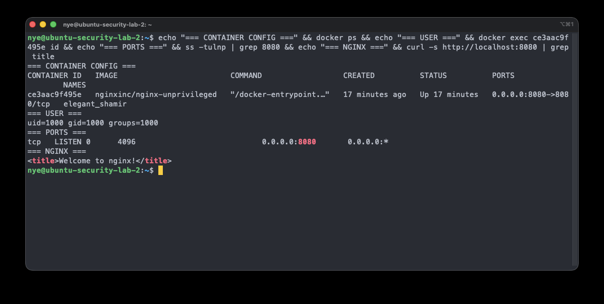

# Lab 07: Virtualization & Container Security

## Overview
Deployed a second VM with full-disk encryption, then ran an Nginx container on it as a non-root user with only one published port, and compared securing a VM vs. a container.

## Objectives
- Deploy a VM and a container securely

## Environment / Tools
- Ubuntu 24.04 LTS VM with LUKS + LVM full-disk encryption
- Docker (`docker.io`), `nginxinc/nginx-unprivileged` image

## Steps

### 1. Create a second VM with full-disk encryption
During install (guided storage): whole 40 GB disk, LVM enabled, LUKS on the LVM group, strong passphrase.



### 2. Install Docker
```bash
sudo apt install docker.io
```


### 3. Run the container as non-root
```bash
docker run -d -p 80:80 -u 1000:1000 nginxinc/nginx-unprivileged
```
- `-d` runs it detached
- `-p 80:80` publishes a single port
- `-u 1000:1000` runs as an unprivileged UID/GID instead of root


### 4. Verify



## Findings


**VM vs. container**

Getting the VM close to CIS compliance took a lot of steps (disabling services, SSH hardening, firewall, kernel settings) and still only scored 67/100 on Lynis. The container was secure with three flags and the right image. Running both together is the better design: if someone escapes the container, they land on a hardened, encrypted VM instead of bare metal. That's the layered approach NIST SP 800-125 describes.

## What I learned
- Container defaults matter. Running as root inside a container is the default unless you change it.
- Containers and VMs aren't either/or. Each one covers gaps in the other.

## Skills demonstrated
Docker / container security, full-disk encryption, defense in depth, NIST SP 800-125
