# Lab 07: Virtualization & Container Security

## Overview
Deployed a second VM with full-disk encryption, then ran an Nginx container on it as a non-root user with only one published port, and compared securing a VM vs. a container.

## Objectives
- Deploy a VM and a container securely
- Harden the VM host and measure the result with Lynis

## Environment / Tools
- Ubuntu 24.04 LTS VM with LUKS + LVM full-disk encryption
- Docker (`docker.io`), `nginxinc/nginx-unprivileged` image

## Steps

### 1. Create a second VM with full-disk encryption
During install (guided storage): whole 40 GB disk, LVM enabled, LUKS on the LVM group, strong passphrase.


### 2. Install Docker
```bash
sudo apt install docker.io
```


### 3. Run the container as non-root
```bash
docker run -d -p 80:80 -u 1000:1000 nginxinc/nginx-unprivileged
```
- `-d` runs it detached
- `-p 80:80` publishes a single port
- `-u 1000:1000` runs as an unprivileged UID/GID instead of root

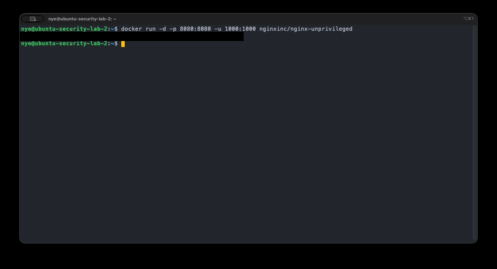

### 4. Verify


### 5. Harden the VM host
Before comparing the two, I hardened the Ubuntu VM against CIS-style recommendations and measured it with Lynis. The recordings below are sped up.

| Step | What I did |
|------|------------|
| Updates | Full `apt` upgrade and `unattended-upgrades` for automatic security patches |
| Tooling | Installed the hardening and audit tools used in the rest of the steps |
| Attack surface | Removed LXD, which the VM didn't need |
| SSH | Tightened `/etc/ssh/sshd_config` (agent and X11 forwarding off, among other settings) and added a warning banner |
| Firewall | UFW with default deny incoming, only the needed ports allowed |
| Accounts | Password quality rules in `pwquality.conf` and account lockout after failed logins |
| Kernel | `sysctl` settings for network and memory protections, applied with `sysctl --system` |
| File systems | Hardened mount options in `/etc/fstab` |
| Auditing | Enabled and started `auditd` |

| | |
|---|---|
| 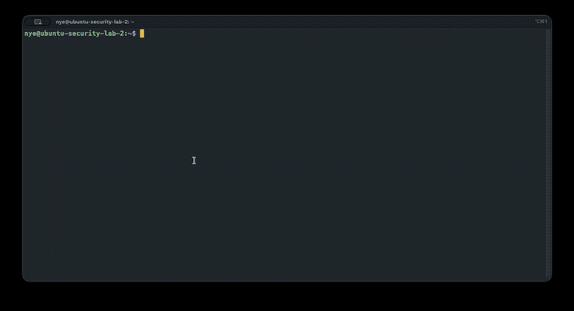 | 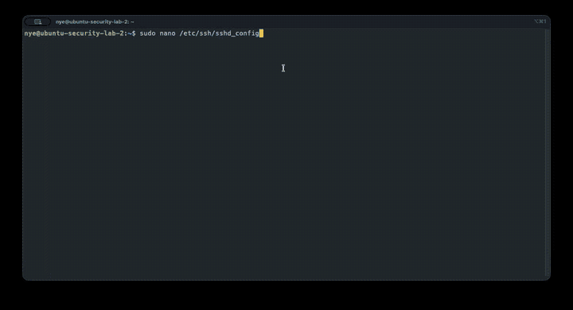 |
| System updates | SSH hardening |
| 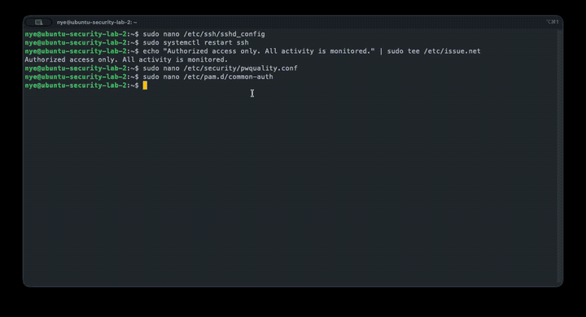 | 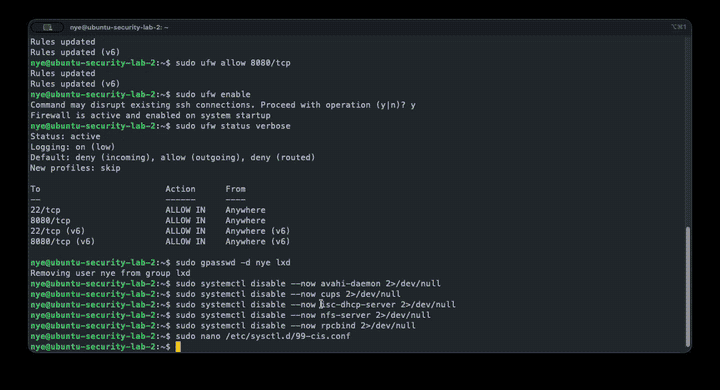 |
| UFW firewall | Kernel `sysctl` hardening |
| 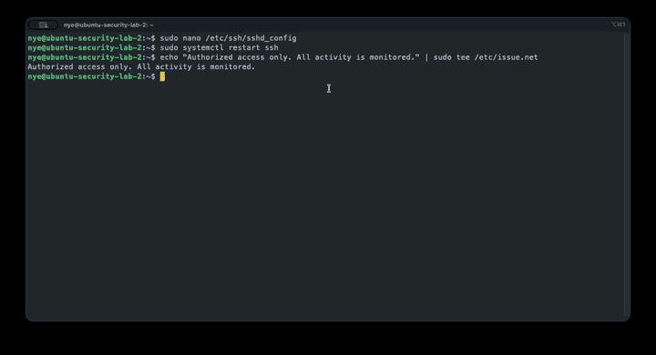 | 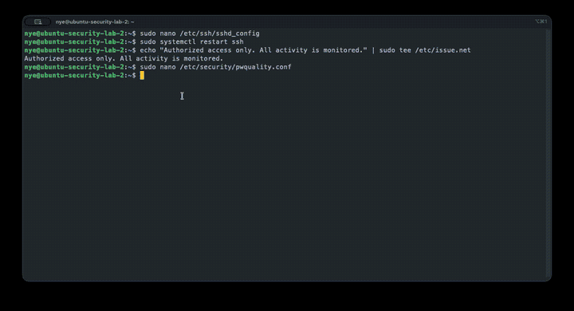 |
| Password policy | Account lockout and banner |
| 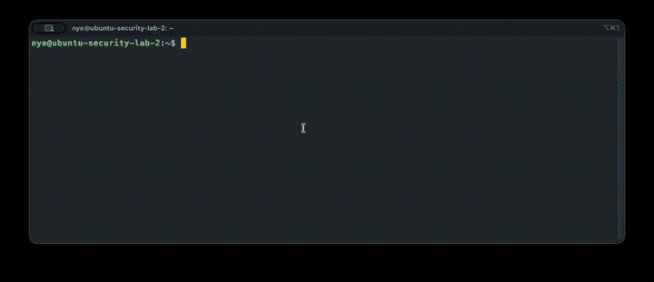 | 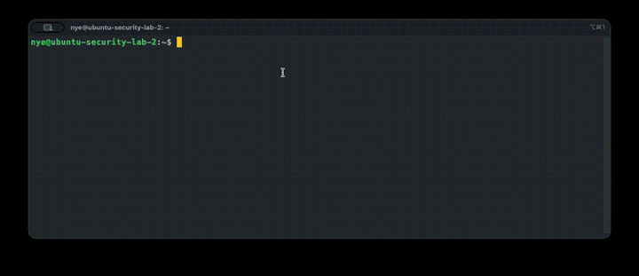 |
| File system mount options | Enabling `auditd` |
| 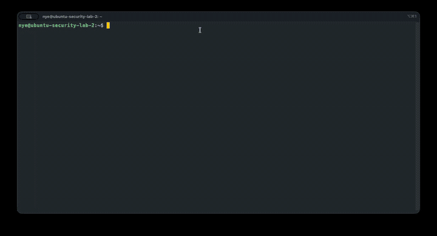 | 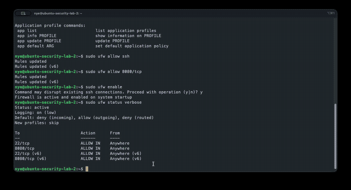 |
| Installing hardening tools | Removing LXD |
| 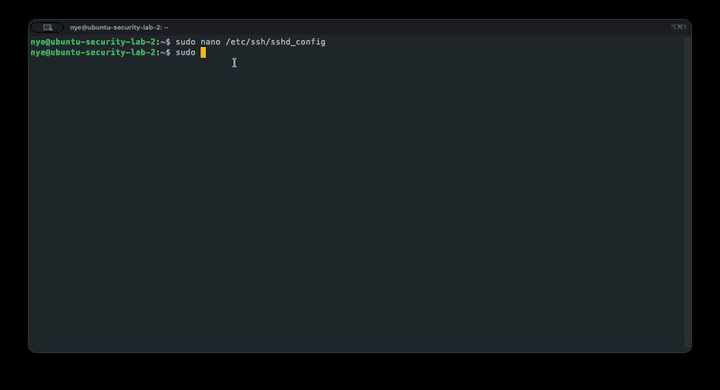 | 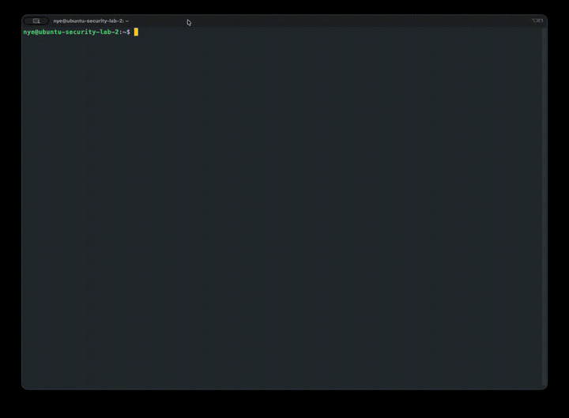 |
| Login warning banner | Applying kernel settings |

## Findings


**VM vs. container**

Getting the VM close to CIS compliance took a lot of steps (disabling services, SSH hardening, firewall, kernel settings) and still only scored 67/100 on Lynis. The container was secure with three flags and the right image. Running both together is the better design: if someone escapes the container, they land on a hardened, encrypted VM instead of bare metal. That's the layered approach NIST SP 800-125 describes.

## What I learned
- Container defaults matter. Running as root inside a container is the default unless you change it.
- Containers and VMs aren't either/or. Each one covers gaps in the other.

## Skills demonstrated
Docker / container security, Linux hardening (SSH, UFW, sysctl, auditd), Lynis, full-disk encryption, defense in depth, NIST SP 800-125
