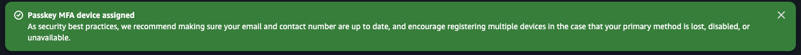
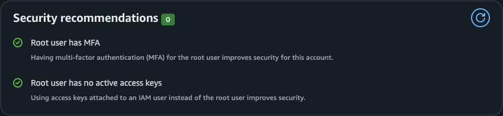
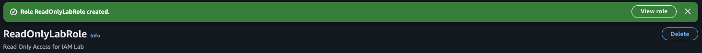
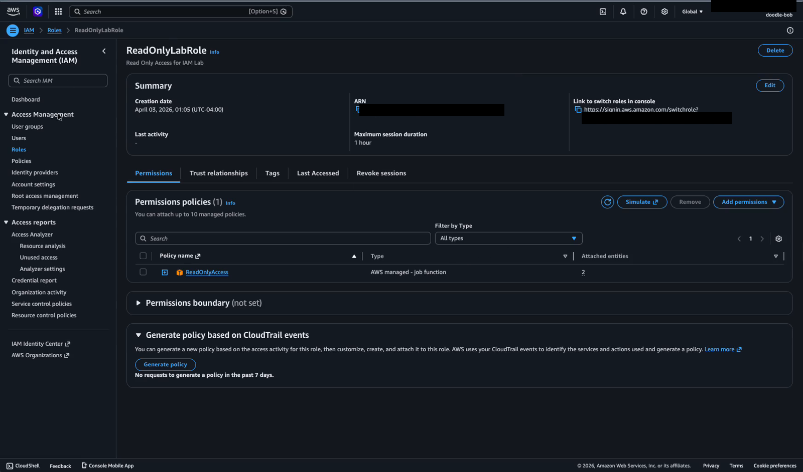
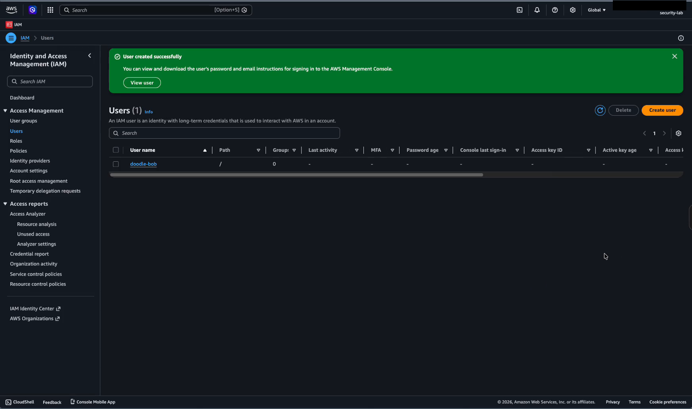
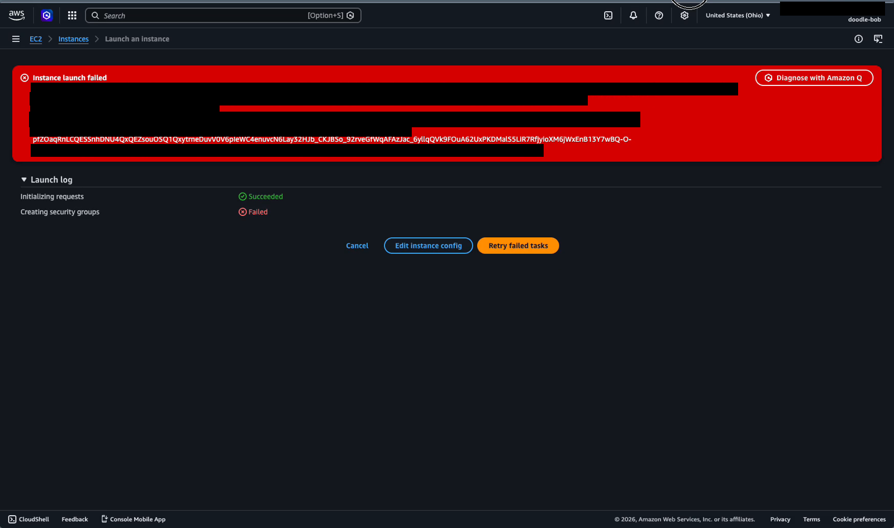
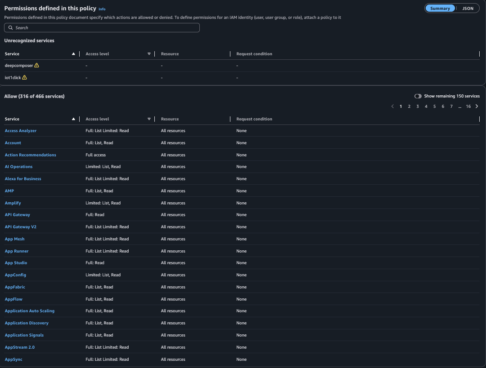

# Lab 08: Cloud IAM & Access Control

## Overview
Set up an AWS account securely (MFA on root), created a read-only IAM role and a test user, and proved least privilege by having that user try to launch an EC2 instance.

## Objectives
- Apply the shared responsibility model
- Secure cloud access

## Environment / Tools
- AWS (IAM, EC2), AWS Management Console
- `ReadOnlyAccess` managed policy

## Steps

### 1. Secure the root account with MFA

### 2. Create a read-only IAM role

### 3. Create a test user with read-only access
Created `doodle-bob` and attached the read-only role.

### 4. Test access
Read actions worked. Launching an EC2 instance was denied:

## Findings

`doodle-bob` could view resources but couldn't create, modify, or delete anything. The EC2 launch failed with an explicit authorization error, confirming the policy was enforced.

## What I learned
Least privilege means granting only the access a user needs for their tasks, and reviewing it over time. In the shared responsibility model, AWS secures the infrastructure, but identity and access configuration is entirely on the customer.

## Skills demonstrated
AWS IAM, MFA, least privilege, access testing
