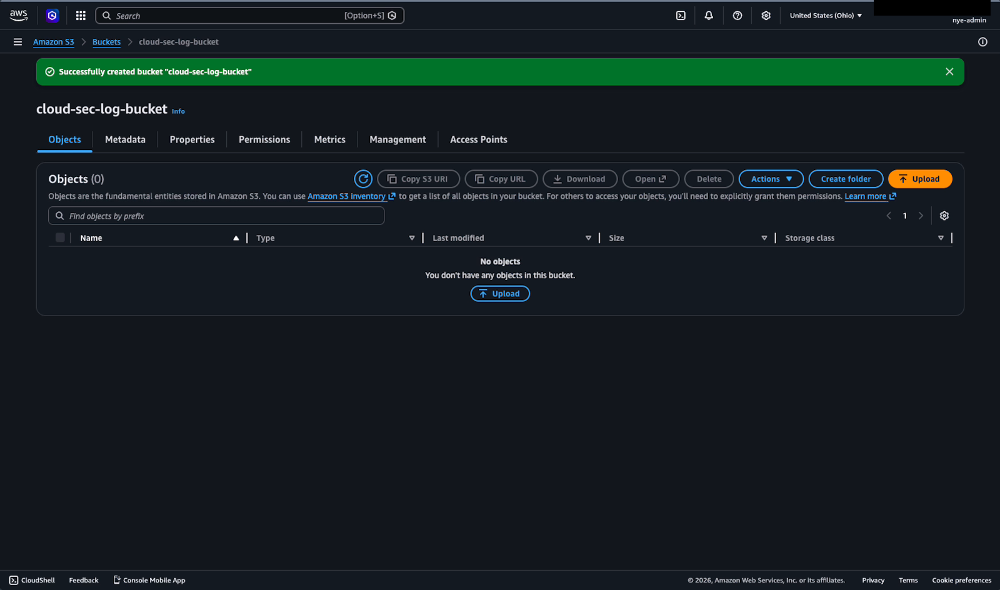
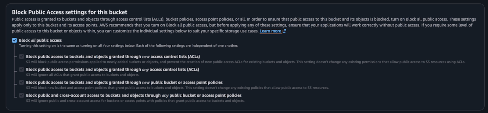
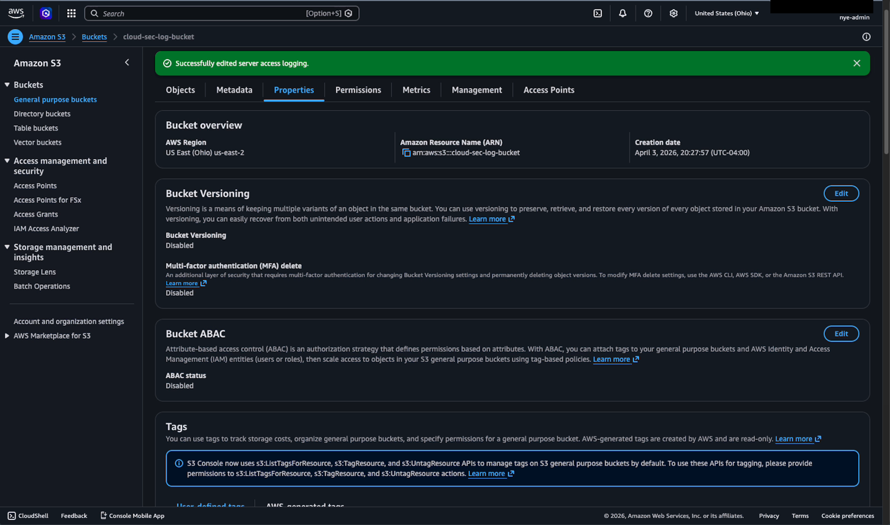
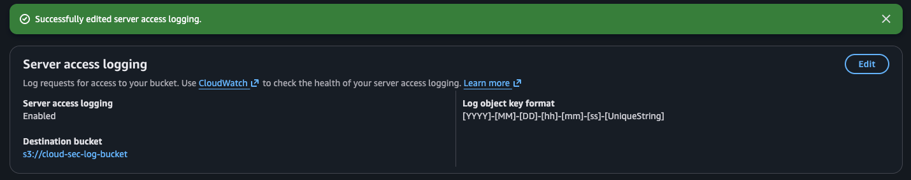
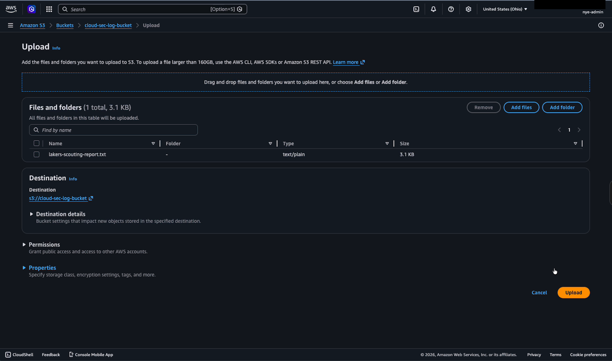
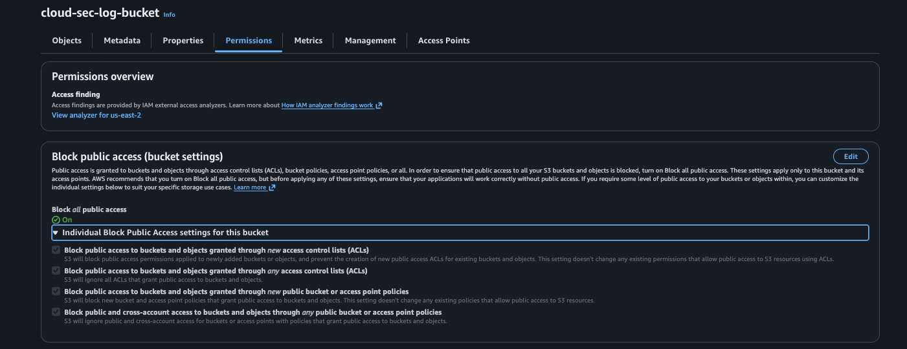
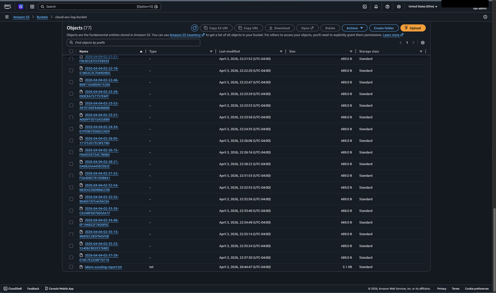
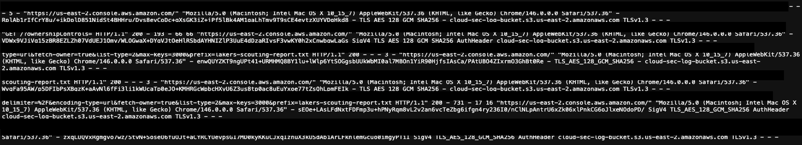

# Lab 09: Cloud Storage Security & Logging

## Overview
Created a private S3 bucket, blocked all public access, enabled server access logging, and generated upload/download events to confirm they showed up in the logs.

## Objectives
- Secure cloud storage
- Enable monitoring

## Environment / Tools
- AWS S3 (Block Public Access, server access logging)
- A dummy text file as test data

## Steps

### 1. Create the bucket

### 2. Block public access

### 3. Enable server access logging

### 4. Trigger events
Uploaded and downloaded a test file.

## Findings

- All four Block Public Access settings are on.
- Access logs recorded the `PUT`, `GET`, and `HEAD` requests for the test file, including the requester, operation, status code, and TLS details.

## What I learned
- S3 access logs aren't real-time. Entries can take a while to appear, so they're better for after-the-fact review than live alerting.
- Logs are only useful if they can't be tampered with. [Lab 11](../11-incident-response-simulation/) adds Object Lock for that.

## Skills demonstrated
AWS S3 security, logging and monitoring, log review
