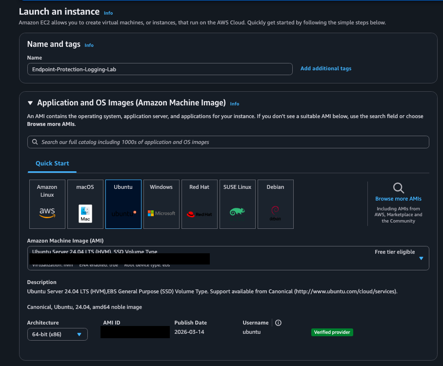
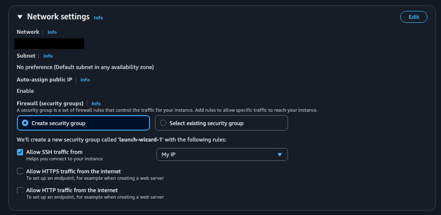
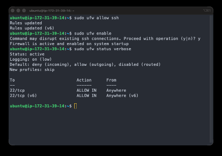
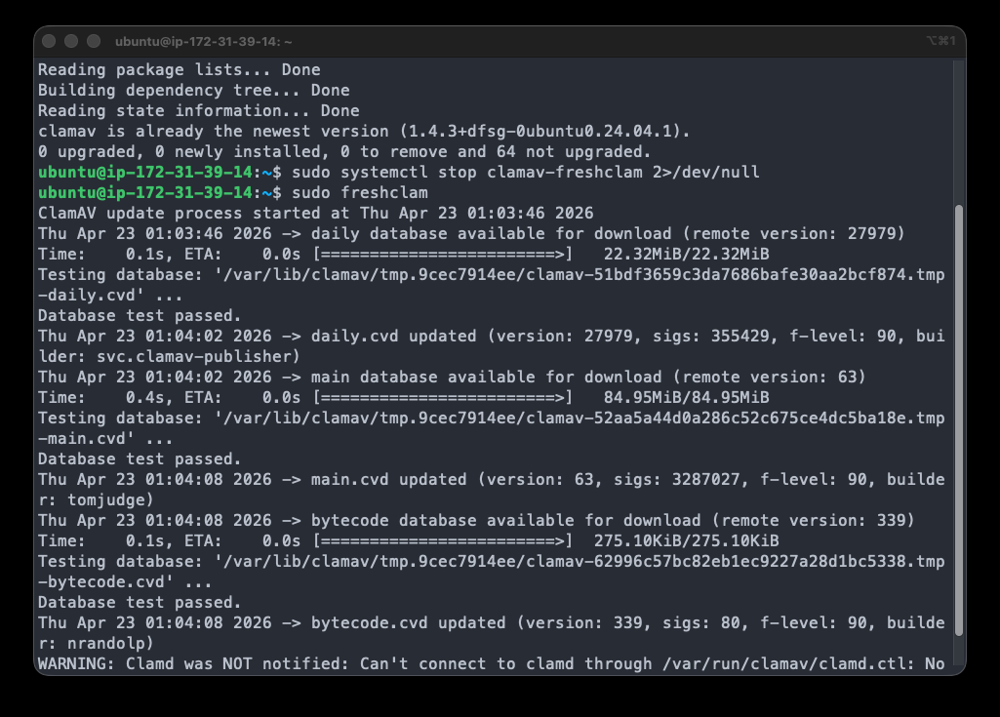
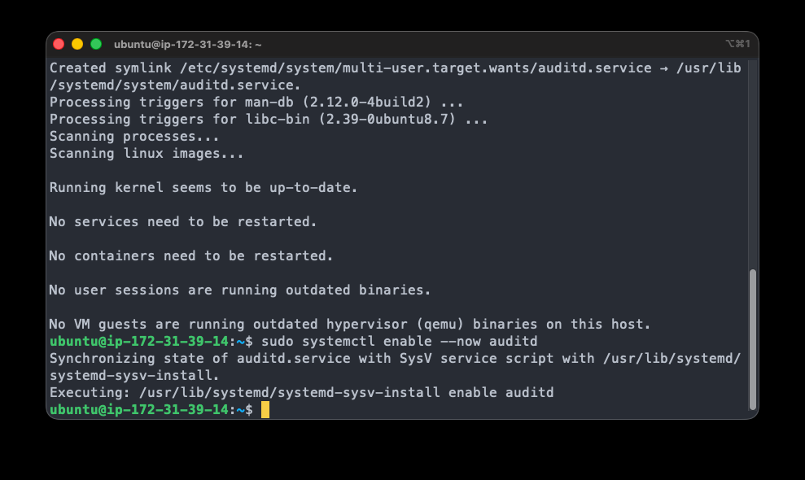
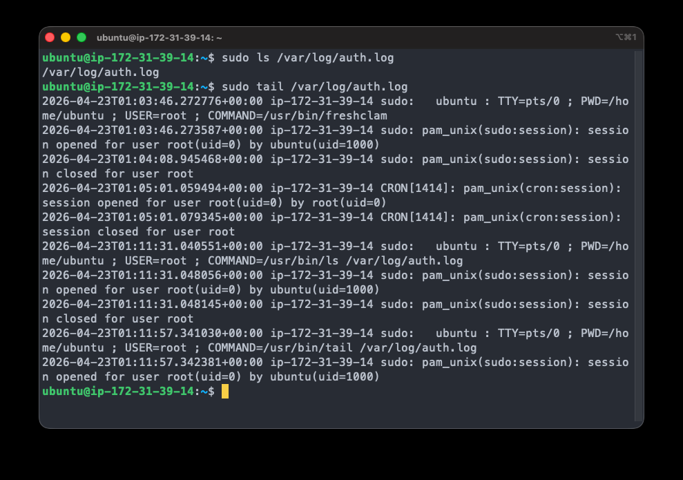
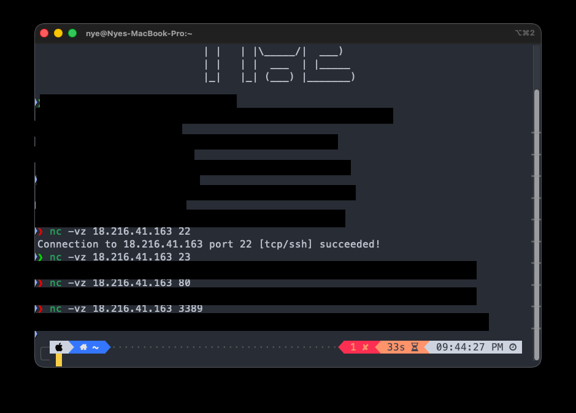
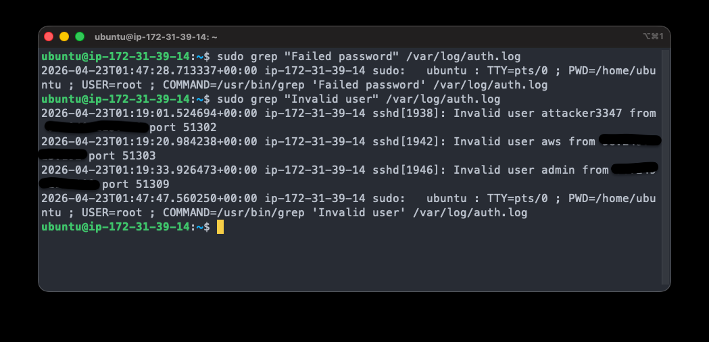
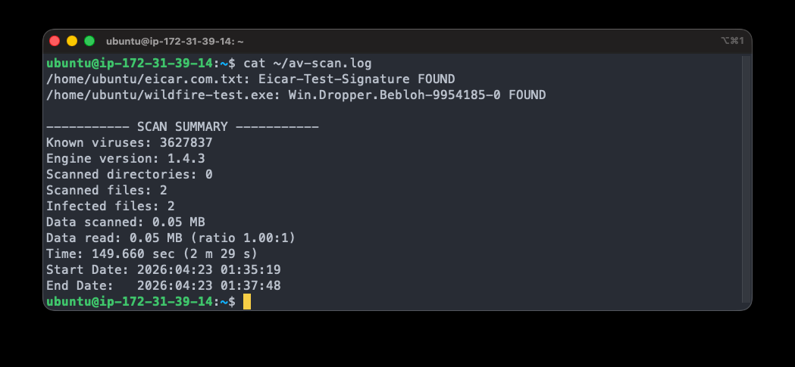
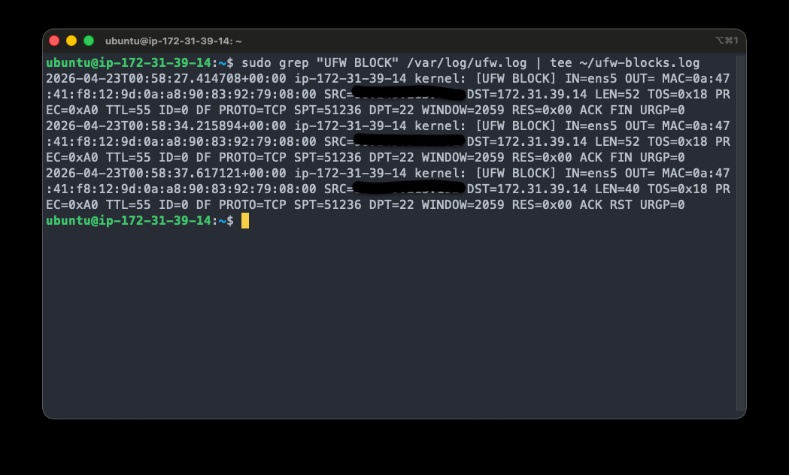

# Lab 10: Endpoint Protection & Log Analysis

## Overview
Launched an Ubuntu EC2 instance, layered a cloud firewall, a host firewall, antivirus, and audit logging on it, then generated suspicious activity (bad SSH logins, port probes, a test malware file) and found each event in the logs.

## Objectives
- Detect threats
- Analyze logs

## Environment / Tools
- AWS EC2 (Ubuntu Server 24.04 LTS), security groups
- UFW, ClamAV, auditd, `/var/log/auth.log`
- EICAR test file

## Steps

### 1. Launch the instance


### 2. Firewalls
Cloud level (security group), allowing SSH only:



Host level (UFW):



### 3. Antivirus


### 4. Audit logging



### 5. Generate events
SSH attempts with fake usernames, plus port probes on 23, 80, and 3389:



### 6. Analyze logs
```bash
sudo grep "Failed password" /var/log/auth.log
sudo grep "Invalid user" /var/log/auth.log
sudo clamscan eicar.com.txt | tee ~/clamav-scan.log
sudo grep "UFW BLOCK" /var/log/ufw.log
```

## Findings




| Activity | Evidence |
|----------|----------|
| Brute force / credential guessing | `Invalid user attacker3347 / aws / admin` entries in `auth.log` |
| Malware | ClamAV flagged the EICAR test file (`Eicar-Test-Signature FOUND`) |
| Reconnaissance | Port probes blocked by the security group, plus `UFW BLOCK` entries |

## What I learned
- Using both a security group and UFW means one misconfiguration doesn't expose the host.
- Simple `grep` patterns go a long way, but this is exactly the kind of thing a SIEM automates at scale.

## Skills demonstrated
AWS EC2 security, host firewalls, antivirus, Linux log analysis, threat detection
