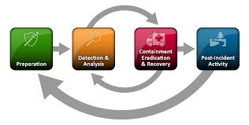
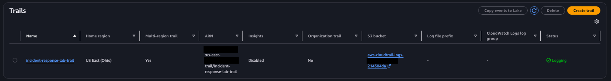
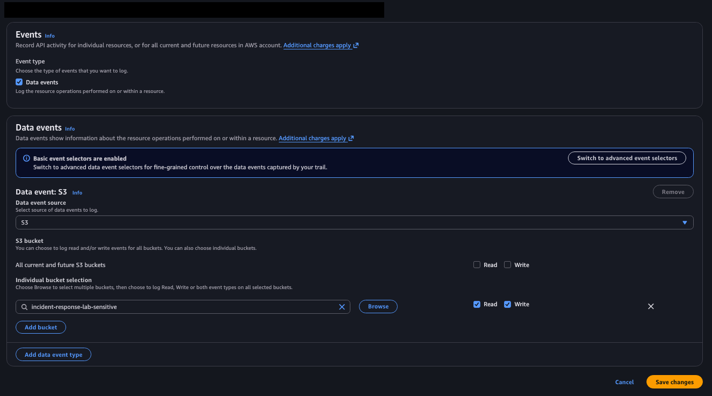
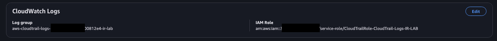
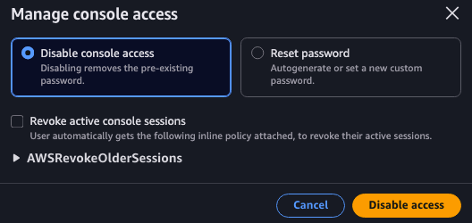
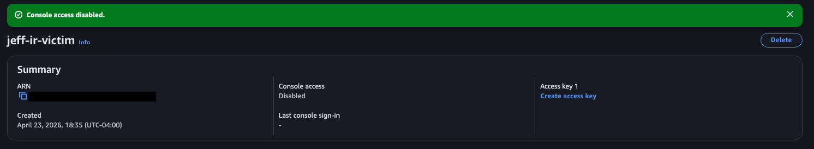
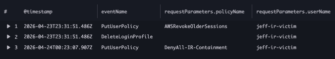
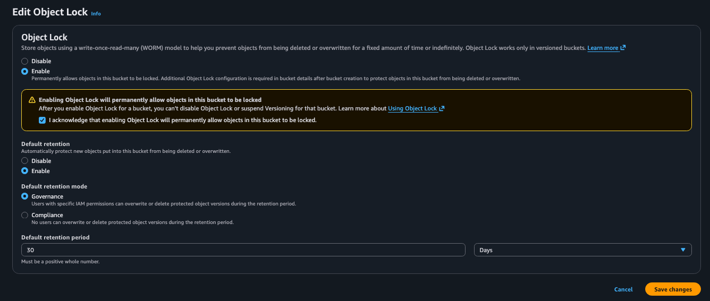
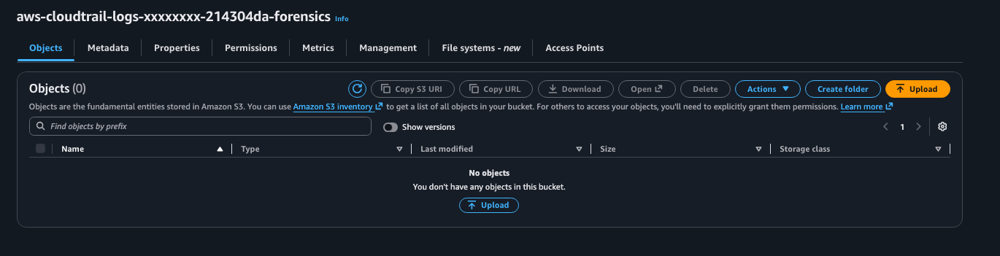
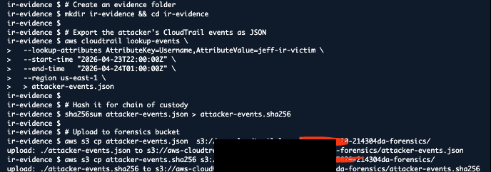

# Lab 11: Incident Response Simulation (AWS)

## Overview
Simulated and investigated a cloud incident end to end using the NIST SP 800-61 lifecycle. **Scenario:** multiple failed console logins followed by unauthorized access to files in S3. I set up the logging, ran the attack against a test user, hunted for it in CloudWatch Logs Insights, contained the account, preserved the evidence, and wrote an incident report.

All data in the target bucket was dummy data created for this lab.

## Objectives
- Detect and investigate an incident from cloud logs
- Contain it without destroying evidence
- Preserve logs for forensics and document a timeline

## Environment / Tools
- AWS CloudTrail (management + S3 data events), CloudWatch Logs Insights
- IAM, S3 (Object Lock), AWS CLI
- NIST SP 800-61, MITRE ATT&CK



## Steps

### 1. Preparation
- Created a CloudTrail trail and added S3 data events for the target bucket
- Created the bucket `incident-response-lab-sensitive` with dummy sensitive files
- Created the victim user `jeff-ir-victim`
- Sent CloudTrail to CloudWatch Logs so it could be queried






### 2. Detection & analysis
CloudWatch Logs Insights queries, mapped to MITRE ATT&CK:

**T1110 Brute Force** (failed logins)
```sql
fields @timestamp, userIdentity.userName, sourceIPAddress, errorMessage
| filter eventName = "ConsoleLogin" and errorMessage like /Failed/
| sort @timestamp asc
```

**T1078 Valid Accounts** (successful login with the guessed password)
```sql
fields @timestamp, userIdentity.userName, sourceIPAddress
| filter eventName = "ConsoleLogin" and userIdentity.userName = "jeff-ir-victim"
| sort @timestamp asc
```

**T1530 Data from Cloud Storage** (file access)
```sql
fields @timestamp, eventName, userIdentity.userName, sourceIPAddress,
       requestParameters.bucketName, requestParameters.key
| filter eventName = "GetObject" and userIdentity.userName = "jeff-ir-victim"
| sort @timestamp asc
```

### 3. Containment
1. Disabled the console password (`DeleteLoginProfile`)
2. Revoked active sessions (`AWSRevokeOlderSessions`)
3. Attached an explicit deny-all inline policy (`DenyAll-IR-Containment`)





Validation query:
```sql
fields @timestamp, eventName, requestParameters.policyName, requestParameters.userName
| filter requestParameters.userName = "jeff-ir-victim"
  and eventName in ["DeleteLoginProfile", "PutUserPolicy", "UpdateAccessKey"]
| sort @timestamp asc
```


### 4. Evidence preservation
- Enabled S3 Object Lock (Governance mode, 30-day retention) on the log bucket
- Exported the attacker's events to a separate forensics bucket and hashed them (SHA-256)
- Ran `aws cloudtrail validate-logs` to confirm log integrity





## Findings

### Timeline (UTC, 2026-04-23/24)
| # | Time | Actor | Action | ATT&CK |
|---|------|-------|--------|--------|
| 1 | 22:50:55 | Attacker | 6 failed `ConsoleLogin` attempts | T1110 Brute Force |
| 2 | 22:50:55 | Attacker | Successful `ConsoleLogin` | T1078 Valid Accounts |
| 3 | 22:53:05 | Attacker | Console enumeration (`DescribeRegions`, `ListApplications`) | T1580 Cloud Infrastructure Discovery |
| 4 | 22:55:35 | Attacker | Bucket inspection (`GetBucketVersioning`, `GetBucketPolicy`, `HeadBucket`) | T1619 Cloud Storage Object Discovery |
| 5 | 22:57:13 | Attacker | 8 `GetObject` calls, 4 unique files | T1530 Data from Cloud Storage |
| 6 | 23:31:51 | Responder | `DeleteLoginProfile` on `jeff-ir-victim` | |
| 7 | 23:31:51 | Responder | `PutUserPolicy` → `AWSRevokeOlderSessions` | |
| 8 | 00:23:07 | Responder | `PutUserPolicy` → `DenyAll-IR-Containment` | |
| 9 | post-containment | Responder | Logs locked (Object Lock, 30 days) and validated | |

### Impact
| Dimension | Impact |
|-----------|--------|
| Users affected | 1 (`jeff-ir-victim`) |
| Resources | 1 S3 bucket, 4 objects read |
| Confidentiality | Compromised (customer PII, employee PII, financials, credentials file; all dummy) |
| Integrity | Intact, no writes or deletes |
| Availability | Intact |
| Lateral movement | None detected |

### Why these response choices
- **Disabled, didn't delete.** Deleting the user would have destroyed the audit trail. Disabling the password stops access and keeps the evidence.
- **Three layers of containment.** Authentication (password removed), session (tokens revoked), and authorization (explicit deny, which overrides any allow in IAM).
- **Tamper-evident evidence.** Object Lock plus log file validation and SHA-256 hashes keep the chain of custody intact.

## What I learned
- Containment and forensics pull in opposite directions. The goal is to stop the attacker without destroying the evidence you need.
- CloudTrail data events aren't on by default. Without them, the S3 file access in this scenario would have been invisible.
- Mapping each step to MITRE ATT&CK made the timeline much easier to explain.

## Skills demonstrated
Incident response (NIST SP 800-61), AWS CloudTrail and CloudWatch Logs Insights, threat hunting, MITRE ATT&CK, IAM containment, digital evidence handling
